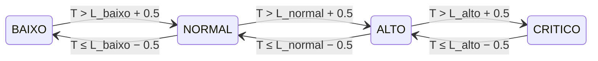

# temp-monitor-loading

Monitor de temperatura embarcado em **ESP32-S3-N16R8**. Este é o projeto que envio para a 3ª etapa do processo seletivo da Loading.


## Limitações do projeto

O ESP32-S3 possui apenas um sensor de temperatura **interno**, que mede a temperatura do **próprio chip** (a pastilha de silício) e o desafio pedia um monitor de temperatura funcional.

Portanto, sem disponbilidade de um sensor de temperatura externo, para contornar isso e concluir um protótipo apresentável, **elaborei uma equação própria** bem simples que usa da temperatura interna do chip para **inferir** a temperatura do ambiente externo e as suas variações, usando valores fixos de multiplicador/deslocamento.

### A equação

Na inicialização o firmware lê a temperatura do chip uma vez (`T_chip,0`) e a usa como referência:

```
T_amb,0 = T_chip,0 − OFFSET_FIXO                      (OFFSET_FIXO = 8,0 °C)

T_amb   = T_amb,0 + MULT · (T_chip − T_chip,0)        (MULT = 3,0)
```

| Constante | Valor | Papel no modelo |
|---|---|---|
| `TEMP_OFFSET_FIXED` | `8.0` | Assume que, ao ligar, o chip está ~8 °C acima do ambiente. Define o ponto de partida da estimativa. |
| `TEMP_OFFSET_MULT` | `3.0` | Cada 1 °C de variação no chip vira 3 °C de variação estimada no ambiente. Faz o valor reagir de forma visível. |


Esta foi **uma opção criativa para fechar o protótipo e poder demonstrá-lo**. Eu entendo que a temperatura inferida **não representa, de fato, a temperatura real do ambiente**. Limitações conhecidas do modelo:

- **Referência relativa ao boot.** A estimativa é ancorada na primeira leitura. Se o ESP32 for reiniciado com o chip já aquecido, o ponto de partida estará errado.
- **O chip esquenta por outros motivos.** A temperatura interna também depende de carga de CPU, frequência e periféricos, não só do ar ao redor.
- **O multiplicador amplifica ruído.** Qualquer oscilação de ±0,2 °C no chip vira ±0,6 °C na estimativa. É um dos motivos pelos quais a histerese foi considerada fundamental nessa implementação.

Já que o resto do código não depende de como a temperatura é obtida, em um produto real, bastaria trocar `estimate_ambient_temp()` por uma leitura de um sensor externo.

## Requisitos implementados

- [X] Leituras periódicas do sensor de temperatura do aparelho
- [X] Exibir os valores de temperatura lidos de maneira clara
    - [X] Monitor serial
- [X] Estados relativos a temperatura do aparelho
    - [X] Falha/Indefinido
    - [X] Normal
    - [X] Alerta
    - [X] Crítico
    - [X] Exibir alterações de estados pelo led RGB
- [X] Leitura inválida de temperatura
    - [X] Simular leitura inválida
    - [X] Alertar condição de falha
- [X] Definição de valores limites de temperatura
    - [X] Alterar em run-time (Opcional)

**Extras:**
- [X] **Histerese** na transição entre estados (margem de 0,5 °C), evitando que o LED e o estado fiquem "piscando" perto de um limiar.


## Hardware e pinagem

| Item | Detalhe |
|---|---|
| Microcontrolador | ESP32-S3-N16R8 (16 MB flash, 8 MB PSRAM, não houve necessidade de usar a PSRAM) |
| Placa configurada | `esp32-s3-devkitc-1` (PlatformIO) |
| Framework | Arduino (core ESP32) |
| Console | USB/serial a **115200 baud** |
| Sensor de temperatura | Sensor interno do chip (`temperatureRead()`) |

Nenhum componente externo é necessário. Os "botões" são **pinos de toque capacitivo** do próprio ESP32-S3.

| Pino | Função | Como acionar |
|---|---|---|
| **GPIO 14** | Aumenta o limiar **BAIXO** | Tocar e segurar |
| **GPIO 10** | Aumenta o limiar **NORMAL** | Tocar e segurar |
| **GPIO 3** | Aumenta o limiar **ALTO** | Tocar e segurar |
| **GPIO 7** | Simula **leitura inválida** do sensor | Tocar e segurar |
| **GPIO 48** | LED RGB (endereçável) | Saída; já vem na placa |


O limite de leitura que define "tocado" é um valor bruto fixo por pino no código `get_gpio_touch()`, que foram obtidos através de testes e observação empírica.


## Compilar e gravar

Requer [PlatformIO](https://platformio.org/).

```bash
git clone https://github.com/Anthhon/temp-monitor-loading.git
cd temp-monitor-loading

pio run -t upload   # Compila e grava no chip
pio device monitor  # Abre o monitor serial
```

> Toda a configuração relevante do projeto pode ser encontrada no arquivo: `platformio.ini`

## Manual de uso

### Ligando o aparelho

Ao ligar a placa por USB, o monitor serial deve começar a exibir informações após um período fixo de 3 segundos de espera. Um led branco também será aceso durante o período de inicialização/calibração do aparelho.

Por fim, o monitor mostra as informações do chip e os limiares padrão:

```
[[ INFORMAÇÕES DO CHIP ]]
- Modelo do chip: ESP32-S3
- Flash: 16.00MB (16777216 bytes)
[[ LIMIARES DE TEMPERATURA DEFINIDOS ]]
- Temperatura baixa <= 10 | Temperatura normal <= 45 | Temperatura alta <= 60 > Temperatura crítica
[[ INICIANDO SENSORIAMENTO DE TEMPERATURA ]]
```

O sensor é lido pela primeira vez e essa leitura vira a **referência de calibração** do modelo de estimativa elaborado anteriomente.

**Se essa leitura falhar** o LED fica **roxo**, o monitor mostra `Erro ao inicializar sensor!` e o aparelho **trava de propósito** para não operar com calibração inválida! (Sendo necessário reiniciar a placa)

> Para uma estimativa mais coerente, ligue a placa com o chip frio, sem ter acabado de rodar outro firmware pesado.

### Tabela de estados e cores do LED

| `Estado` | Nome | Cor do LED | Quando ocorre |
|:-:|---|---|---|
| — | *(inicialização)* | Branco | Na inicialização antes da primeira leitura |
| `1` | **BAIXO** | Ciano | Ambiente estimado ≤ limiar baixo |
| `2` | **NORMAL** | Verde | Entre o limiar baixo e o limiar normal |
| `3` | **ALTO** | Amarelo | Entre o limiar normal e o limiar alto |
| `4` | **CRÍTICO** | Vermelho | Acima do limiar alto |
| `0` | **INDEFINIDO** | Roxo | Ainda não há valor de estado válido (falha na leitura/inicialização) |

> As cores usam intensidade baixa (`0x12` de 255) para não prejudicar a visão de quem olhar diretamente ao aparelho


## Estados e limiares de temperatura

O sistema possui **3 limiares dinâmicos**, ajustáveis em tempo de execução pelos GPIOs **14**, **10** e **3**.

Que acabam dividindo a faixa de temperatura em **4 estados operacionais**. O quinto estado, **INDEFINIDO**, não faz parte da faixa e serve apenas para sinalizar que o estado **ainda não possui valor ou para sinalizar um erro** na leitura.

(Cada limiar é o **limite superior** do seu estado)

```

 -40                 10                      45                60                   125
  ├───────────────────┼───────────────────────┼─────────────────┼─────────────────────┤
  │       BAIXO       │        NORMAL         │      ALTO       │       CRÍTICO       │
  │      (ciano)      │        (verde)        │    (amarelo)    │     (vermelho)      │
  │      Estado 1     │       Estado 2        │    Estado 3     │      Estado 4       │
  └───────────────────┴───────────────────────┴─────────────────┴─────────────────────┘
                      ▲                       ▲                 ▲
                      │                       │                 │
                limiar BAIXO            limiar NORMAL      limiar ALTO
                  GPIO 14                  GPIO 10            GPIO 3
                (padrão: 10)             (padrão: 45)      (padrão: 60)

```

Qualquer leitura que resulte em uma temperatura abaixo de -40ºC e mais de 125ºC é também considerada um erro de leitura, já que o sensor de temperatura do chip é incapaz de ler valores além desse raio.

### Mapa de transições



Em qualquer estado, uma **leitura inválida** leva a **INDEFINIDO**. Quando a leitura volta a ser válida e o estado é reavaliado diretamente pelos limiares sem histerese.

## Alterando os limiares em tempo de execução

Toque e **segure** o pino correspondente:

| Pino | Limiar alterado |
|---|---|
| GPIO 14 | BAIXO |
| GPIO 10 | NORMAL |
| GPIO 3 | ALTO |

- Enquanto o pino estiver tocado, o limiar sobe **+1 °C por segundo**.
- Ao chegar ao fim da faixa, o valor **dá a volta** (*wrap-around*) para o início da faixa permitida, então não é preciso um segundo botão para diminuir.
- A ordem `BAIXO < NORMAL < ALTO` é **sempre preservada**.

## Sobre a histerese

Quando a temperatura estimada oscila ligeiramente perto de um limiar, um sistema simples alternaria de estado a cada ciclo, fazendo o LED piscar diferentes cores.

A **histerese** no entanto garante que cada estado mantém uma "margem de erro". O estado atual então só muda quando a temperatura sai dessa zona estendida pela **margem de histerese de 0,5 °C** (`HYSTERESIS_MARGIN`).

## Simulando uma leitura inválida

Para demonstrar o tratamento de falha sem danificar nada, o pino **GPIO 7** força a simulação de um defeito enquanto estiver tocado, fazendo com que a leitura seja considerada inválida.

> Se o GPIO 7 estiver tocado **durante o boot**, a leitura de calibração falha e o aparelho trava.
